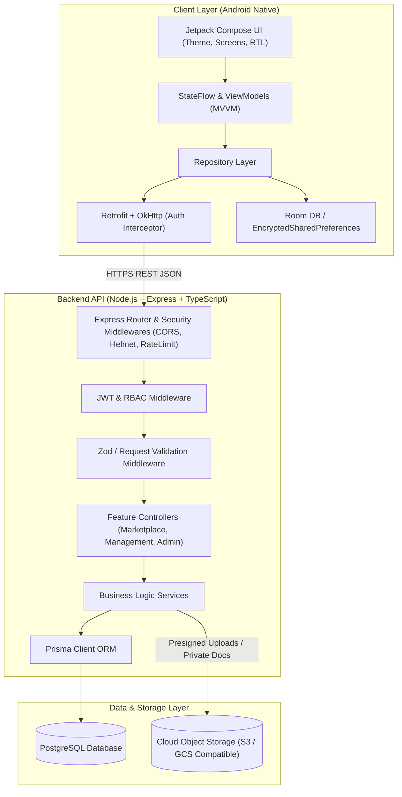

# ARK Real Estate — System Architecture

## 1. Executive Summary

**ARK Real Estate** is an end-to-end property marketplace and management platform tailored for the Pakistan real estate sector. The solution connects buyers, renters, owners, agents, and property managers while maintaining institutional trust, bilingual support (English and Urdu with full RTL mirroring), administrative verification, and localized compliance.

---

## 2. Core Architectural Principles

1. **Bilingual First & RTL Native**: First-class support for English (LTR) and Urdu (RTL) with layout mirroring, typographic baseline compensation, and localized numeral/currency formatting.
2. **Explicit Trust & Verification Workflow**: Public search feeds strictly exclude unreviewed, pending, or rejected listings. All property submissions undergo an administrative verification workflow before publication.
3. **Manual Rent Record Keeping**: In MVP, the platform acts strictly as an auditable ledger. ARK never processes, collects, or disburses funds. Payment records are marked as "Recorded / Logged" with an audit trail, explicitly distinguished from "Payment Processed".
4. **Defense-in-Depth Security**: Passwords are securely hashed (Argon2id/bcrypt). Authorization is enforced on every backend route. Sensitive tenancy contracts and national identity documents are stored in secure cloud object storage with time-limited signed URLs, never exposed publicly.
5. **Precise Financial Ledger**: All monetary amounts (PKR) use `Decimal`/`Numeric` types in PostgreSQL and Prisma to eliminate IEEE 754 floating-point rounding errors.

---

## 3. High-Level System Architecture Diagram

---

## 4. Mobile Architecture (Android Native)

### 4.1 Tech Stack
- **Language**: Kotlin 2.x
- **UI Toolkit**: Jetpack Compose (Material 3 tailored design tokens from Stitch)
- **Navigation**: Navigation Compose with type-safe routing
- **Architecture**: MVVM (Model-View-ViewModel) + Repository Pattern
- **Reactive State**: Kotlin Coroutines & `StateFlow`
- **Networking**: Retrofit 2.x, OkHttp 4.x with Auth / Interceptor pipeline
- **Image Loading**: Coil Compose with disk and memory caching
- **Secure Persistence**: Android Jetpack `EncryptedSharedPreferences` for auth tokens and user preferences

### 4.2 Layer Responsibilities
- **UI Layer (`ui/`)**: Pure declarative Composable functions. Handles layout direction (`LayoutDirection.Rtl` vs `LayoutDirection.Ltr`), typography (`Plus Jakarta Sans` for English, `Noto Nastaliq Urdu` / `Noto Sans Arabic` for Urdu), and design tokens (Navy `#0B1E36`, Gold `#C5A059`, Canvas `#F8FAFC`).
- **ViewModel Layer (`viewmodel/`)**: Exposes unidirectional `UiState` data classes (`Loading`, `Success`, `Error`, `Empty`) via `StateFlow`. Dispatches user intents to repositories.
- **Repository Layer (`data/repository/`)**: Coordinates remote API calls, offline caching, and business transformations.
- **Network Layer (`data/remote/`)**: Retrofit API interfaces, authentication token refresh interceptors, and robust network error mapping (`NetworkError`, `ValidationError`, `AuthError`).

---

## 5. Backend Architecture (Node.js + Express + TypeScript)

### 5.1 Tech Stack
- **Runtime**: Node.js 20+ LTS
- **Language**: TypeScript 5.x (Strict mode)
- **Framework**: Express.js
- **Database Access**: Prisma ORM with PostgreSQL
- **Validation**: Zod schema validation for all query, body, and param inputs
- **Authentication**: JWT (Access Token + Rotating Refresh Token) with password hashing via `argon2` / `bcrypt`
- **Security**: `helmet`, `cors`, `express-rate-limit`, secure HTTP-only cookies
- **Testing**: Jest / Supertest for unit and integration testing

### 5.2 Layer Responsibilities
- **Middlewares (`middlewares/`)**:
  - `authMiddleware`: Validates JWT, populates `req.user`.
  - `roleMiddleware`: Enforces Role-Based Access Control (`BUYER_RENTER`, `OWNER_AGENT`, `PROPERTY_MANAGER`, `ADMIN`).
  - `validateRequest`: Zod-based payload validation with standardized 422 error structures.
  - `errorHandler`: Global exception handler returning uniform JSON error responses.
- **Controllers (`controllers/`)**: Parse HTTP input, delegate to services, format JSON response.
- **Services (`services/`)**: Core domain logic, transaction management, ledger integrity rules.
- **Prisma Client (`prisma/`)**: Type-safe database queries, migrations, and relationship enforcement.

---

## 6. Cloud Object Storage Architecture

Images and documents are **never stored directly in PostgreSQL**.
- **Public Assets** (Property listing photos, agency logos):
  - Stored in a public cloud bucket (e.g. AWS S3, Cloudflare R2, or Google Cloud Storage).
  - Served via CDN with responsive image presets (thumbnail, card, hero, full resolution).
- **Private Documents** (Lease agreements, CNIC / Identity proofs, title deeds, expense receipts):
  - Stored in a private, non-public bucket.
  - Accessed exclusively through **short-lived pre-signed URLs** (e.g. valid for 15 minutes) issued only to authorized owners, tenants, or administrators.

---

## 7. Role-Based Access Control (RBAC) Matrix

| Resource / Action | Guest | Buyer / Renter | Owner / Agent | Property Manager | Admin |
| :--- | :---: | :---: | :---: | :---: | :---: |
| Browse Approved Listings | Yes | Yes | Yes | Yes | Yes |
| Search & Filter Properties | Yes | Yes | Yes | Yes | Yes |
| Save Favourites | No | Yes | Yes | Yes | Yes |
| Submit Viewing Request / Inquiry | No | Yes | Yes | Yes | Yes |
| Submit New Property Listing | No | No | Yes | Yes | Yes |
| Review / Approve / Reject Listings | No | No | No | No | **Yes** |
| Manage Units, Leases & Tenants | No | No | Owned only | Assigned only | Full |
| Record Manual Rent Payment | No | No | Owned only | Assigned only | Full |
| Log Expenses & Maintenance | No | No | Owned only | Assigned only | Full |
| Access Financial Audit Logs | No | No | Owned only | Assigned only | Full |

---

## 8. Localization & RTL Architecture

- **Supported Locales**: `en-PK` (English - Pakistan, default) and `ur-PK` (Urdu - Pakistan).
- **RTL Layout Engine**: Android Jetpack Compose `CompositionLocalProvider(LocalLayoutDirection provides LayoutDirection.Rtl)`.
- **Text & Number Shaping**:
  - English: `Plus Jakarta Sans`
  - Urdu: `Noto Nastaliq Urdu` / `Noto Sans Arabic` with +20% line-height baseline compensation.
  - Currency: `PKR 45,000,000` / `PKR 4.5 Crore` / `PKR 85 Lac` / `4.5 کروڑ روپے`.
  - Land Measurement: Marla (225 sq ft), Kanal (20 Marlas / 4,500 sq ft), Square Feet, Square Yards.
